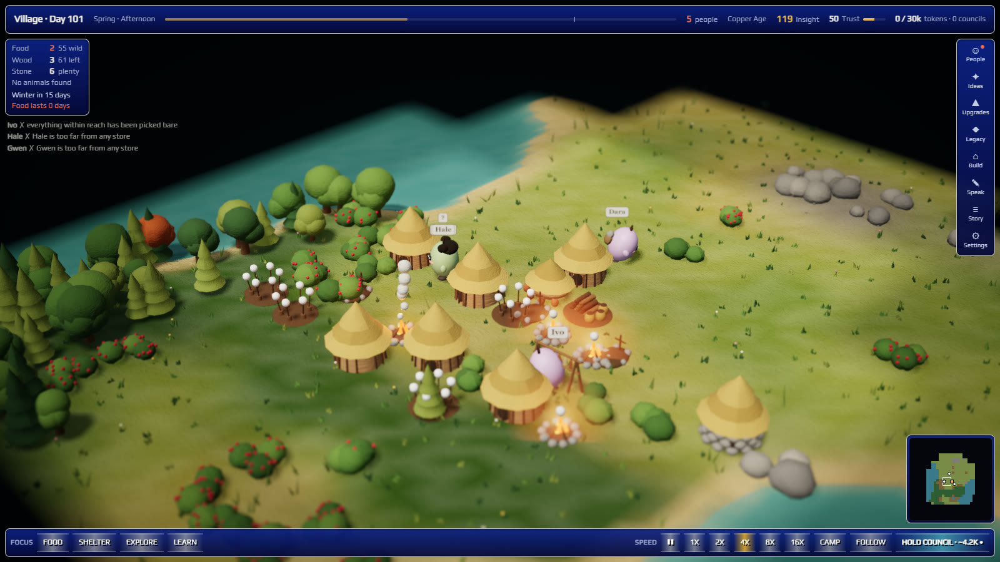

# Hermes Incremental Village



A 3D Stone Age village whose villagers are played by Hermes. It starts with three: Ash, Bryn and Coll.
You are their guide, not their god: you give advice, and they decide what to do.

- **The villagers only know what they can see.** Each villager's view covers 4 tiles in every
  direction, plus their own short memory and what others have told them. They cannot walk to a
  place they have never seen, and they must talk to coordinate.
- **The game is the referee.** Every action (look, walk, gather, build, talk, trade, teach, rest, experiment, deposit, take, hunt) is
  checked against position, energy, skills, materials and daylight. An invalid action fails,
  costs time, and the villager hears about it the next day.
- **The village is alive.** A day lasts 2 real minutes. You watch the villagers walk, chop,
  pick, build, talk and rest on the map, and the camp grows from Camp to Hamlet to Village.
- **Resources work like the real thing.** Forest is finite and slow to return: cut it bare and it only
  regrows as young trees seed from a neighbouring tile, unless the village learns coppicing and tends
  a woodlot. Stone never runs out, but it is heavy. Fires burn wood from the camp store every night,
  and go out without it. Villagers need water, fields tire unless rested, grain keeps and meat spoils.
  Deer and boar roam beyond the camp, breed in spring, and can be hunted out for good. The readout shows
  what the village holds and what it has found; land nobody has explored does not count.
- **Survival is real, and villagers die for good.** A year is 20 days. Bushes run out and regrow
  slowly, carried food rots, and nothing grows in winter. Hunger, cold and wolves all cost health,
  and a villager who reaches 0 dies and leaves a grave. If everyone dies while you are playing,
  the village has fallen and you start again.
- **Needs drive progress.** Picking bushes bare can teach someone farming. Fields must be near
  water, shelter must be near where you sleep, and a fire keeps wolves away. Huts add beds, and a
  wanderer may join when there is a spare bed and everyone is eating well.
- **Land with no edge.** Like Minecraft, a seed grows the world chunk by chunk as someone gets close, in
  every direction, with slow changes from plains to deep forest, lake country and rocky highs. A villager
  walks at most 24 tiles a day, so resources near camp run down and there is always more further out.
  Long walks carry across days, so villagers sleep where night finds them. The save holds only what has
  changed and what has been seen, so the world's size costs nothing.
- **Nomads first.** The band shelters where it stops and can raise new lean-tos and fires anywhere.
  Depots are cheap caches for goods too far to haul home. Moving on, hauling and settling down are all
  real choices with real costs.
- **The map starts dark.** Land nobody has seen is black, explored land is dim, and only what villagers
  can see right now is clear. Animals show up only while someone can see them. Land far past what anyone
  has seen is never generated or sent to the page; the nearest chunks are sent ahead so the ground can
  be drawn up to the edge of the dark.
- **Days flow into nights.** Dusk, night and dawn run as one cycle. Villagers sleep through the dark and
  pick up where they stopped. A council's plans start at the next dawn, so nobody jumps.
- **You control the clock.** Pause, or run at 1x, 2x, 4x, 8x or 16x. Speed and pause only last while
  the page is open: 30 seconds after you leave, time returns to 1x.
- **It keeps going while you're away.** When you come back, the days you missed are worked out
  from the villagers' habits and you get a summary, including anyone who died. Up to 30 days count
  per absence. Unwatched days can kill villagers, but never the last one.
- **Free days keep them alive; councils move them forward.** Without any model call, villagers
  follow their habits and instincts: eat, fetch wood, raise a first lean-to, wander. Skills,
  trades and every later building need a plan.
- **You are the guide, not a god.** You cannot move anyone or place anything. You earn Insight as
  the village lives, builds and even loses people, then spend it on ideas and upgrades. Ideas follow
  real history, and villagers must test each one with an experiment that can fail. Your focus is
  judged by results: good advice raises Trust, and below 40 Trust they ignore you on free days. When
  a village ends, it leaves Legacy, which buys permanent starting advantages for the next one.
- **A council is your decision.** It is one batched model call that plans every villager's day
  at once, about 1–3k tokens, never one call per villager or per action. The panel tells you
  when one is worth it.

Eras after copper, relationships, and optional extras for the Three Stage, Hermes Maps
and Screen Overlay plugins are planned but not built.

## Using it

| Where | How |
|---|---|
| Desktop | Open **Village** in the sidebar. The village fills the page: status and the population run along the top, focus, speed and the council button dock at the bottom, and People, Ideas, Upgrades, Legacy, Build, Speak, Story and Settings open from the right. |
| Any chat | `/village` (status), `/village plan`, `/village speed <pause|1|2|4|8|16>`, `/village habit` (skip to a new free day), `/village guide <advice>`, `/village budget <tokens>`, `/village ideas`, `/village plant <idea>`, `/village upgrade <name>`, `/village focus <food\|shelter\|explore\|learn>` |
| Agent tools | `village_status`, `village_guide`, `village_habit_day`, `village_plan_day` (toolset `village`) |

### Install

```bash
hermes plugins install tuancookiez-hub/hermes-incremental-village
```

Then turn the plugin on under **Capabilities → Plugins** in Desktop and open **Village** in the sidebar.
There is nothing else to set up: the rules are plain Python inside the plugin.

For local development, link or copy this folder to `<HERMES_HOME>/plugins/hermes-village`, run
`hermes plugins enable hermes-village`, and restart the gateway so the backend routes mount.

### The optional Rust engine

The same rules also exist in Rust, in `engine-rs/`, and the tests hold the two equal day by day. The
plugin never downloads or builds it. If you install it yourself, the plugin uses it, which helps most
when catching up many missed days:

```bash
cargo install --path engine-rs --locked
```

The plugin checks the engine's version, rules and protocol when it starts it. If it is missing, out of
date or stops, the built-in Python rules carry on with the same save. `HERMES_VILLAGE_BACKEND=python`
or `=rust` forces one.

### Rebuilding the Desktop page

```bash
cd web && npm ci && npm run build && npm run check
```

The build writes `desktop/plugin.js`: one unminified ES module that contains three.js r187.
Its only imports are `@hermes/plugin-sdk`, `react` and `react/jsx-runtime`.

### Getting around

Drag to turn the view, scroll to zoom, and click a villager to follow them. The map in the corner shows
everything they have seen; click it to look there. Space pauses, 1 to 5 set the speed, C goes to camp,
P shows the people, F follows the group and Esc closes what is open. Sound is off until you turn it on in Settings, and it is
made in the page, so nothing is downloaded.

## Costs, data, network and background work

- **Model cost.** Only a council spends tokens: one `ctx.llm.complete_structured` call with
  `max_tokens` 1500 (plus 400 per villager beyond the first 3), run against your active model. You can route it to a cheaper model by
  pinning the **Village planner** auxiliary slot in Settings → Models.
- **Daily cap.** The default is 30,000 tokens per calendar day; change it in the panel or with
  `/village budget`. A council is refused *before* the call if the worst case (estimated input
  plus the output cap) would go over the cap. Every call is written to the plugin's ledger.
  If the provider reports no usage, a conservative estimate is charged instead.
- **Hermes does not report dollar cost to plugins** in this version (`usage.cost_usd` is not
  filled in), so the budget is counted in tokens.
- **No background work or spending.** The plugin starts no timers, threads or schedulers. Nothing
  runs while nobody is looking: time is caught up when the village is next read, by the page or a
  village tool or command. Catch-up uses habits and instincts only and can never call a model.
  Councils happen only when you ask for one, and are refused inside a cron run. The Desktop page
  re-reads the state every 5 seconds, and when a day ends, only while it is open and visible; those
  reads are free.
- **One optional child process.** Only if you have installed the Rust engine yourself, Hermes starts
  one copy of `hermes-village-engine` per process that uses the plugin and talks to it over stdin and
  stdout. It listens on no port, opens no network connection, reads and writes no files, and exits
  when Hermes does. Without it, no process is started at all.
- **Network.** None, apart from the model calls Hermes makes for a council through your configured
  provider. The plugin downloads nothing: no engine, no remote assets or scripts, and no telemetry.
- **Data.** The village save and the token ledger live in Hermes plugin storage at
  `<HERMES_HOME>/plugin-data/hermes-village/data.db` (SQLite), along with the village's written
  history. Your welcome, look and sound choices stay in this browser. The plugin reads no files outside that folder and never
  touches credentials.
- **What the model sees.** Only the game rules, the villagers' local views, memories and what
  they heard, plus your guidance. It sees nothing from your conversations or files.
- **Updates.** No self-update or remote code loading.

## Layout

```
plugin.yaml, __init__.py      agent half: tools, /village, "Village planner" model slot
village/rules.json            every game constant and table
village/pyengine.py           the rules in Python: clock, catch-up, perception, validation, replay
village/engine.py             one set of names in front of the Python rules and the Rust engine
village/bridge.py             starts the optional Rust engine and talks to it over a pipe
village/planner.py            council prompt and JSON schema
village/service.py            shared operations, token budget gate, spend ledger
village/store.py              SQLite in Hermes plugin storage
dashboard/plugin_api.py       read/write routes for the Desktop page (never call a model)
desktop/plugin.js             built Desktop page (do not edit; edit web/src)
web/                          Desktop page source (React + three.js) and build
engine-rs/                    the same rules in Rust (optional)
tests/                        python -m pytest tests; reference_engine.py is the frozen copy of the
                              rules that both engines are compared with
docs/population-design.md     the approved design for what comes next
spike/                        offline models used to design the council budget and population
```

## License

MIT. three.js is MIT and bundled; see `THIRD_PARTY_NOTICES.md`.
